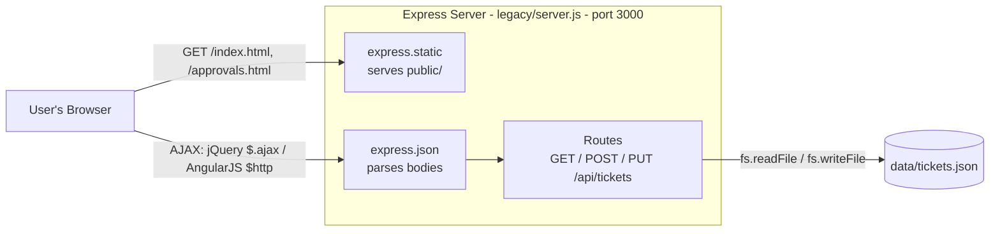
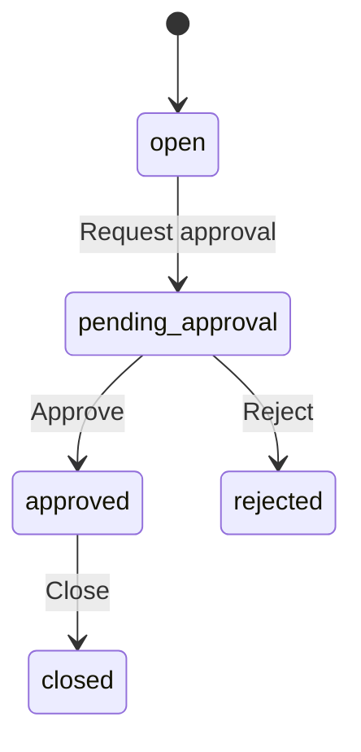

# Legacy Architecture (v0.1.0)

## Components
| Component | Technology | Role |
|---|---|---|
| index.html | jQuery 3 | Ticket list + create form |
| approvals.html | AngularJS 1.8 | Approval workflow |
| server.js | Node + Express 4 | REST API + static file server |
| tickets.json | JSON file | Data storage |
| migration/dxl/helpdesk-sample.xml | Lotus Notes DXL (XML) | Sample export of the original Notes database |

## API

| Method | URL | Used by | Purpose |
|---|---|---|---|
| GET | `/api/tickets` | index.html, approvals.html | List all tickets |
| GET | `/api/tickets/:id` | — | Get one ticket |
| POST | `/api/tickets` | index.html | Create a ticket (status always starts as `open`) |
| PUT | `/api/tickets/:id` | approvals.html | Change a ticket's status (validated against allowed values) |

## Status workflow

## Known issues (to fix in modernization)

### Back end (server.js)
- `var` everywhere instead of `const`/`let`
- Callbacks nested inside callbacks ("callback hell") instead of `async`/`await`
- File-reading code duplicated in every route
- Manual `for` loops instead of array methods (`find`, `filter`, `map`)
- `==` used to compare a number ID with a string URL parameter, hiding the type mismatch
- PUT response relies on `var i` leaking out of the loop (`tickets[i]`); breaks if converted to `let`
- Everything in one file: setup, middleware, and all routes
- Hard-coded port (3000) and file path instead of configuration (`.env`)
- Mixed coding styles (arrow functions and `function`, `var` and `const`)
- Inconsistent error responses (some plain text, some JSON)

### Data
- JSON file used as a database: whole file read and rewritten on every change
- IDs generated manually (max + 1); deleting the newest ticket lets its ID be reused
- Two requests saving at the same time can overwrite each other's changes
- No schema: any shape of data can be saved

### Validation and security
- POST has no validation: empty, wrong-type, unknown-priority, or very long values are saved
- No authentication: anyone can create, approve, reject, or close tickets
- No authorization: no roles (requester / approver / admin)
- XSS in the jQuery page: ticket fields are inserted into HTML as raw strings

### Front end
- jQuery page builds HTML by string concatenation
- Manual page refresh: `loadTickets()` must be called after every change
- HTML, CSS, and JavaScript all in one file per page
- Two different front-end technologies (jQuery, AngularJS 1.x) for one app
- AngularJS 1.x reached end of life in January 2022 (no security updates)
- Global functions and variables in page scripts
- No client-side form validation